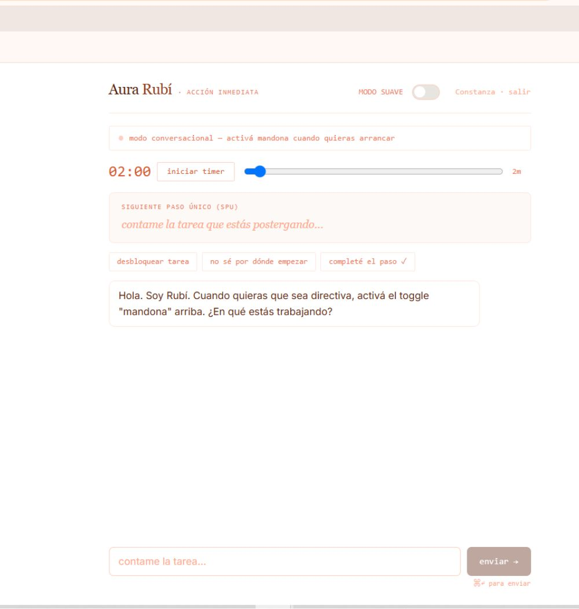
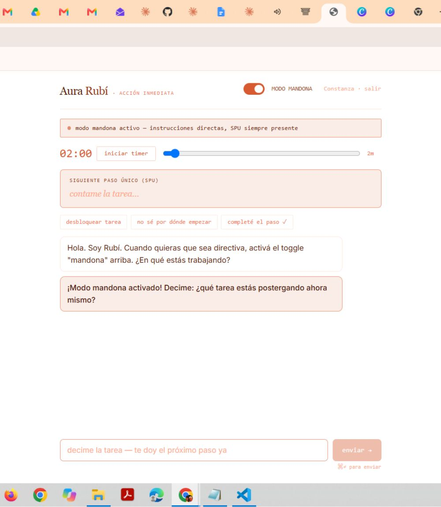
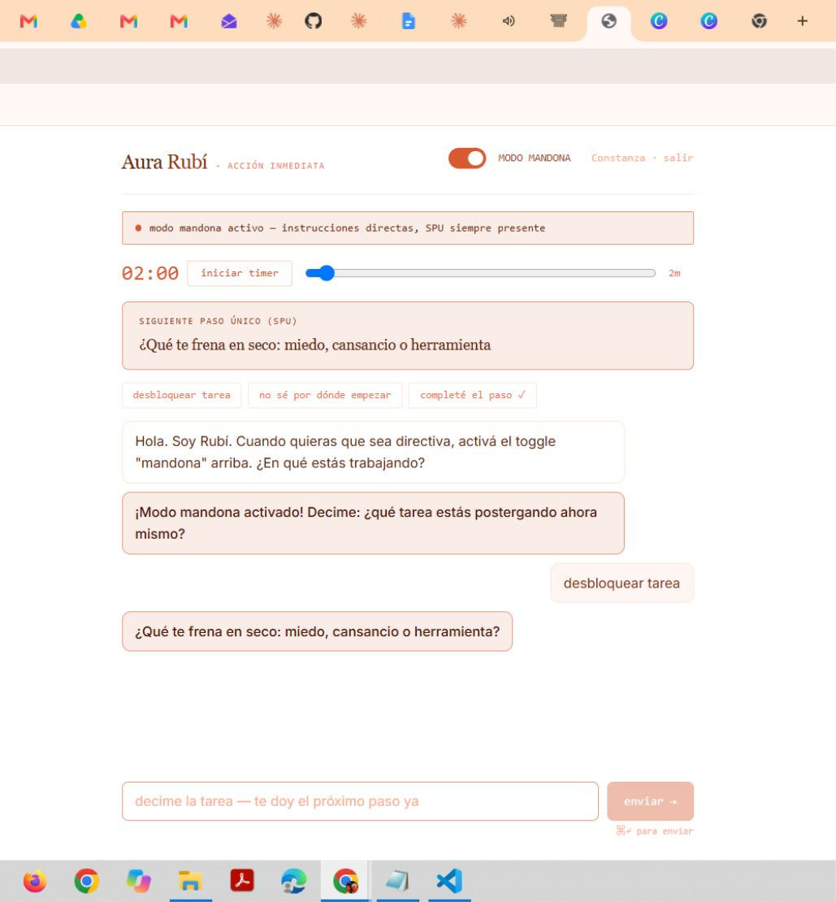
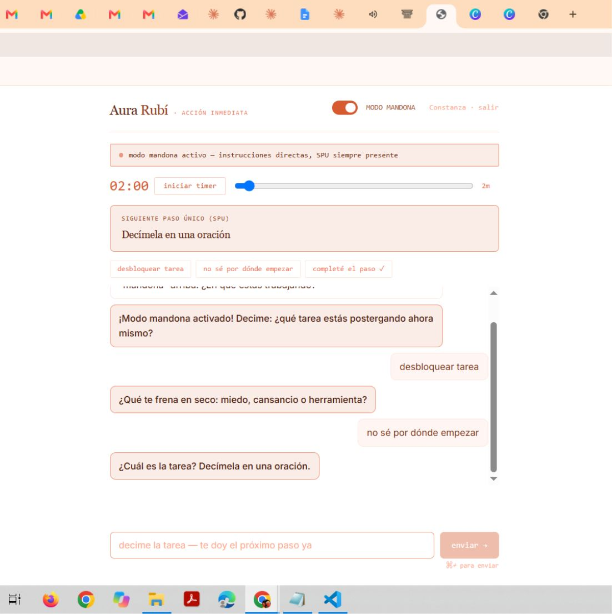
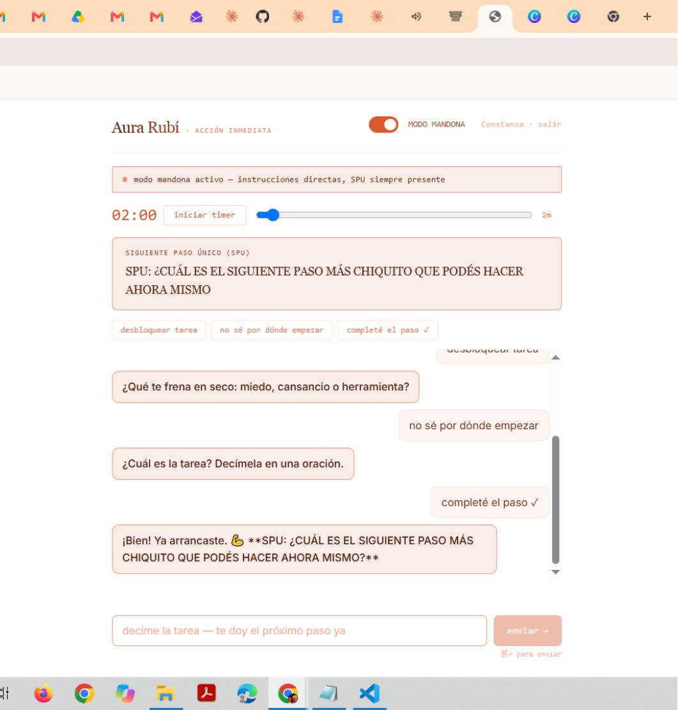

# rubi

# 💎 Aura Rubí: Entrenadora de acción inmediata

**La Wara Studio** · Parte del ecosistema [Aura](https://auracoach.org)

🔗 **App en producción:** https://rubi.auracoach.org

## 📖 Qué es

**Aura Rubí** es una entrenadora de acción inmediata con IA, basada en una sola idea: **ayudarte a dar el siguiente paso único**. En lugar de listas largas o planes completos, Rubí te pide la tarea que estás postergando y te devuelve el paso más chiquito que podés hacer ahora mismo.

Está pensada especialmente con personas **autistas y con TDAH** en mente. Si esa utilidad se sostiene es justamente lo que queremos explorar en el estudio piloto.

## ✨ Funciones principales

1. **Siguiente Paso Único (SPU):** un panel fijo muestra siempre un único paso concreto, actualizado en cada respuesta de Rubí, para reducir la carga de decidir por dónde seguir.
2. **Dos modos de interacción:**
   - **Modo suave:** conversacional; Rubí acompaña y pregunta en qué estás trabajando.
   - **Modo mandona:** instrucciones directas, con el SPU siempre presente, para cuando querés arrancar ya.
3. **Temporizador integrado:** un timer ajustable (2 minutos por defecto) para empezar el paso sin pensar en cuánto va a durar.
4. **Atajos para los momentos de bloqueo:**
   - *desbloquear tarea:* Rubí explora qué frena (miedo, cansancio o no saber qué herramienta usar).
   - *no sé por dónde empezar:* te pide la tarea en una sola oración.
   - *completé el paso ✓:* celebra, cierra el paso y propone el siguiente más pequeño.
5. **Chat libre:** podés escribir la tarea con tus palabras; se envía con Ctrl/⌘ + Enter.

## 🖼️ Capturas

| Modo suave | Modo mandona |
|---|---|
|  |  |

| Desbloquear tarea | No sé por dónde empezar | Completé el paso |
|---|---|---|
|  |  |  |

## 🔬 Estudio piloto

Estamos invitando a investigadoras e investigadores en autismo a un **estudio piloto** de Aura Rubí.

**Objetivo:** explorar la usabilidad y la aceptabilidad de Rubí como apoyo para iniciar tareas en personas autistas y con TDAH, y recoger observaciones sobre los modos (suave/mandona), el paso único y los atajos de bloqueo.

**Qué implicaría participar:**
- Acceso a https://rubi.auracoach.org con cuenta de Google.
- **Duración:** 4 semanas. Semana 0 de inicio (≈20 min), uso libre durante 4 semanas (sugerido: al menos 3 veces por semana) y cierre (≈20 min).
- **Tareas:** cada participante elige 1–3 tareas reales que viene postergando y las trabaja con Rubí.
- **Medidas pre y post:** escalas elegidas para la prueba y metas individualizadas.
- **Feedback:** un check-in semanal de 3 preguntas, un cuestionario final de usabilidad y aceptabilidad, y preguntas abiertas. Entrevista opcional de ≈20 minutos.

**Quiénes lo coordinan:** La Wara Studio, con perspectiva dual como desarrolladora e investigadora en autismo.

**Datos y privacidad:**
- **Rubí no guarda las conversaciones** en sus propios servidores. [COMPLETAR tras verificar: qué sí se guarda, p. ej. solo nombre y email de la cuenta de Google para iniciar sesión.]
- Lo que escribís se envía a la API de Anthropic para generar la respuesta. Según la política de Anthropic para usuarios de API, esos datos se eliminan de sus sistemas dentro de los 30 días y no se usan para entrenar modelos. Pueden retenerse más tiempo si se detecta una violación de su política de uso o por obligación legal.
- En este piloto **no se analizan conversaciones**: los datos de estudio son solo las respuestas a los cuestionarios.
- Quien coordina el piloto accede únicamente a cuestionarios, identificados con un código y no con el email.
- Participar es voluntario, con consentimiento informado previo, y podés retirarte cuando quieras.
- Sugerimos no escribir datos que identifiquen a terceras personas.
- Un estudio posterior podría analizar conversaciones, solo con consentimiento explícito y aprobación ética.

**Contacto:** info@lawara.org

## 🛠️ Arquitectura y stack

| Capa | Tecnología |
|---|---|
| Framework | Next.js 14 (App Router), React 18, TypeScript |
| Estilos | Tailwind CSS 3 |
| Autenticación | NextAuth con Google OAuth |
| IA | Anthropic API (SDK `@anthropic-ai/sdk`) |
| Despliegue | Vercel |

Rubí es una app independiente: no depende de paquetes internos ni de un backend propio.

## 🚀 Cómo ejecutarla en local

1. Cloná el repositorio e instalá dependencias:
   ```bash
   git clone https://github.com/cocoon-web/aura-rubi.git
   cd aura-rubi
   npm install --legacy-peer-deps
   ```
2. Creá tu `.env.local` a partir de `.env.example`:
   ```env
   ANTHROPIC_API_KEY=
   GOOGLE_CLIENT_ID=
   GOOGLE_CLIENT_SECRET=
   NEXTAUTH_SECRET=
   NEXTAUTH_URL=http://localhost:3000
   ```
3. Iniciá el servidor de desarrollo:
   ```bash
   npm run dev
   ```
   La app queda en http://localhost:3000.

## ✅ Calidad

```bash
npm run lint        # ESLint
npx tsc --noEmit    # chequeo de tipos
npm run build       # build de producción
```

## 🌐 Despliegue

Vercel, con Root Directory `.`, install `npm install --legacy-peer-deps`, build `npm run build` y output `.next`. Las variables de entorno se configuran en el panel de Vercel y nunca se versionan.

## 🔐 Seguridad

- No se suben claves ni `.env*` al repositorio.
- En Google Cloud hay que registrar el redirect URI `https://rubi.auracoach.org/api/auth/callback/google`.

---

*Origen: extraído de `apps/rubi` del monorepo `aura-monorepo`, con su historial.*
*Construido por La Wara Studio.*
